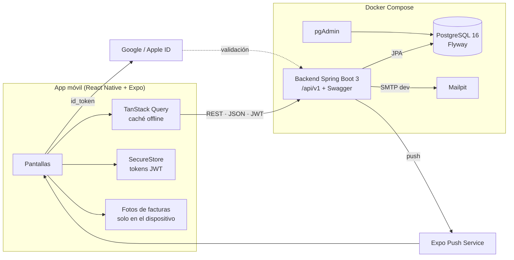

<p align="center">
  
</p>

<h1 align="center">AutoCheck</h1>

<p align="center">
  <b>Tu asistente de salud vehicular.</b><br/>
  Mantenimiento preventivo del coche con semáforo de estado y pasaporte digital inmutable.
</p>

<p align="center">
  
  
  
  
  
  
  
</p>

---

## Índice

- [Qué es AutoCheck](#qué-es-autocheck)
- [Funcionalidades](#funcionalidades)
- [Cómo funciona el semáforo](#cómo-funciona-el-semáforo)
- [Stack tecnológico](#stack-tecnológico)
- [Arquitectura](#arquitectura)
- [Estructura del repositorio](#estructura-del-repositorio)
- [Puesta en marcha](#puesta-en-marcha)
- [Variables de entorno](#variables-de-entorno)
- [Testing](#testing)
- [Integración continua](#integración-continua)
- [Modelo de datos](#modelo-de-datos)
- [Cómo trabajamos](#cómo-trabajamos)
- [Planificación](#planificación)
- [Requisitos](#requisitos)
- [Equipo](#equipo)

---

## Qué es AutoCheck

AutoCheck es una aplicación móvil que ayuda a cualquier conductor, sin conocimientos de mecánica, a saber **cuándo tiene que cambiar cada pieza de su coche** antes de que falle.

A partir del kilometraje y del uso habitual del coche, AutoCheck estima los kilómetros de cada día, calcula cuándo toca cambiar cada consumible y lo resume en un **semáforo** (verde, amarillo, rojo). Cada intervención queda guardada en un **pasaporte digital inmutable**, firmado y verificable con un código QR, que sirve como historial fiable al vender el coche.

Proyecto final de curso desarrollado por un equipo de 3 personas.

## Funcionalidades

| Módulo | Qué hace |
| --- | --- |
| **Autenticación** | Registro con email y contraseña (validación en tiempo real), login con Google y Apple, recuperar contraseña por enlace y borrado de cuenta (RGPD) |
| **Garaje** | Alta de vehículos por matrícula y número de bastidor (VIN), con motorización: gasolina, diésel, híbrido o eléctrico |
| **Calibración de km** | Lectura inicial del odómetro y perfil de uso (urbano < 20 km/día, mixto ~35 km/día, autovía > 70 km/día). Recalibración cada 15–20 días con un toque |
| **Plan de salud preventivo** | Proyección de km y fecha del próximo cambio de cada consumible según la motorización |
| **Semáforo** | Estado global del vehículo en la pantalla de inicio: consumibles y plazos legales (ITV y seguro) |
| **Checklist Seguro + Gatekeeper** | Revisión guiada de niveles. Se bloquea si el motor lleva menos de 2 horas apagado, para evitar quemaduras |
| **Modo Viaje** | Checklist exprés antes de un trayecto largo: presión de neumáticos según la carga, niveles y alumbrado |
| **Pasaporte digital** | Historial de intervenciones que no se puede modificar, con cadena de hashes SHA-256 |
| **Informe PDF** | Exportación del pasaporte firmada con HMAC-SHA256 y código QR de verificación pública |
| **Avisos** | Notificaciones push de ITV (30 días antes), seguro (45 días antes) y consumibles que pasan a amarillo o rojo |
| **Offline-first** | El último estado y el pasaporte se consultan sin conexión |

## Cómo funciona el semáforo

Cada consumible vence por **kilómetros o por tiempo, lo que llegue antes**.

```text
km_hoy          = km_última_lectura + días_desde_lectura × media_diaria
consumo         = max( (km_hoy − km_último_cambio) / intervalo_km ,
                       días_desde_cambio / intervalo_días )
días_restantes  = min( km_restantes / media_diaria ,
                       fecha_último_cambio + intervalo_meses − hoy )
```

| Estado | Condición |
| --- | --- |
| Verde | consumo < 0,80 |
| Amarillo | consumo entre 0,80 y 1,00, menos de 30 días restantes, ITV a menos de 30 días o seguro a menos de 45 |
| Rojo | consumo ≥ 1,00, fallo crítico en el checklist, o ITV o seguro vencidos |
| Gris | consumible sin dato inicial (revisión inicial pendiente) |

El **estado global** es el peor de todos. La **media diaria** es una media ponderada de las 3 últimas lecturas reales (50 %, 30 % y 20 %); con una sola lectura se usa el valor del perfil de uso.

**Ejemplo:** aceite cambiado a 115.000 km, intervalo de 15.000 km, 124.500 km actuales y 35 km/día. El próximo cambio toca a los 130.000 km: faltan 5.500 km, unos 157 días.

### Consumibles por motorización (catálogo inicial)

| Consumible | Gasolina | Diésel | Híbrido | Eléctrico |
| --- | --- | --- | --- | --- |
| Aceite + filtro + arandela del cárter | 15.000 km / 12 m | 15.000 km / 12 m | 15.000 km / 12 m | — |
| Filtro de aire | 30.000 km / 24 m | 30.000 km / 24 m | 30.000 km / 24 m | — |
| Filtro de habitáculo | 15.000 km / 12 m | 15.000 km / 12 m | 15.000 km / 12 m | 15.000 km / 12 m |
| Filtro de combustible | 60.000 km | 30.000 km | 60.000 km | — |
| Bujías | 60.000 km / 48 m | — | 60.000 km / 48 m | — |
| Refrigerante del motor | 120.000 km / 60 m | 120.000 km / 60 m | 120.000 km / 60 m | — |
| Refrigerante de batería | — | — | 160.000 km / 96 m | 160.000 km / 96 m |
| Líquido de frenos | 24 m | 24 m | 24 m | 24 m |
| Pastillas de freno | 40.000 km | 40.000 km | 60.000 km | 80.000 km |
| Neumáticos | 40.000 km / 60 m | 40.000 km / 60 m | 40.000 km / 60 m | 35.000 km / 60 m |
| Correa de distribución | 120.000 km / 72 m | 120.000 km / 72 m | 120.000 km / 72 m | — |
| AdBlue | — | 10.000 km | — | — |
| Filtro de partículas (FAP) | — | 120.000 km | — | — |
| Batería 12 V | 48 m | 48 m | 48 m | 48 m |
| Batería de tracción (SoH) | — | — | 12 m | 12 m |

> Son intervalos orientativos que se cargan con Flyway. Cada usuario puede personalizarlos para su vehículo.

## Stack tecnológico

**Mobile:** React Native con Expo y TypeScript · React Navigation · TanStack Query + Axios · Zustand · React Hook Form + Zod · Expo SecureStore · Expo Notifications · expo-auth-session / expo-apple-authentication

**Backend:** Java 21 · Spring Boot 3 (Web, Security, Data JPA, Validation, Actuator) · JWT (access + refresh) · MapStruct + Lombok · springdoc-openapi (Swagger UI) · OpenPDF + ZXing (PDF y QR) · tareas `@Scheduled`

**Base de datos:** PostgreSQL 16 · Flyway · trigger de inmutabilidad para el pasaporte

**Infraestructura:** Docker (build multi-stage) · Docker Compose (backend, PostgreSQL, pgAdmin, Mailpit) · GitHub Actions

**Testing:** JUnit 5 · Mockito · AssertJ · Testcontainers · MockMvc · JaCoCo · Jest + `@swc/jest` · React Native Testing Library · MSW · Maestro (E2E)

## Arquitectura



- **Toda la lógica de cálculo vive en el backend**, para que haya una única fuente de verdad testeada con JUnit. La app solo muestra el resultado.
- La app nunca accede a la base de datos directamente.
- Las fotos de facturas no salen del móvil: el backend solo guarda su hash.

### Módulos del backend

```
auth · vehicle · odometer · health · checklist · passport · legal · notification
```

Cada módulo tiene sus paquetes `controller`, `service`, `repository`, `dto` y sus tests.

## Estructura del repositorio

```
.
├── backend/                 # API Spring Boot (Maven)
│   ├── src/main/java/...    # Módulos por dominio
│   ├── src/main/resources/
│   │   ├── application.yml
│   │   └── db/migration/    # Migraciones Flyway
│   ├── src/test/java/...
│   ├── Dockerfile
│   └── mvnw
├── mobile/                  # App Expo + TypeScript
│   ├── src/
│   │   ├── app/             # Navegación y pantallas
│   │   ├── components/
│   │   ├── features/        # auth, vehicles, health, checklist, passport...
│   │   ├── api/             # Cliente Axios + hooks de TanStack Query
│   │   ├── store/           # Zustand
│   │   └── i18n/
│   ├── __tests__/
│   ├── .maestro/            # Flujos E2E
│   └── app.json
├── docs/                    # Requisitos, diagramas, memoria y assets
├── .github/
│   ├── workflows/ci.yml
│   ├── pull_request_template.md
│   └── CODEOWNERS
├── docker-compose.yml
├── .env.example
└── README.md
```

## Puesta en marcha

### Requisitos previos

- [Docker Desktop](https://www.docker.com/products/docker-desktop/)
- Node.js 20 LTS
- Java 21 (solo si vas a ejecutar el backend fuera de Docker)
- La app Expo Go en el móvil, o un emulador de Android o un simulador de iOS

### 1. Clonar y configurar

```bash
git clone https://github.com/ORG/REPO.git autocheck
cd autocheck
cp .env.example .env        # y rellena los valores
```

### 2. Levantar el backend y la base de datos

```bash
docker compose up -d --build
```

| Servicio | URL |
| --- | --- |
| API | http://localhost:8080/api/v1 |
| Swagger UI | http://localhost:8080/swagger-ui.html |
| Health check | http://localhost:8080/actuator/health |
| pgAdmin | http://localhost:5050 |
| Mailpit (emails de prueba) | http://localhost:8025 |

Flyway crea las tablas y carga el catálogo de consumibles al arrancar.

### 3. Arrancar la app móvil

```bash
cd mobile
npm ci
npx expo start
```

Pulsa `a` para abrir el emulador de Android, `i` para el simulador de iOS, o escanea el QR con Expo Go.

> **URL de la API desde el móvil:** en el emulador de Android usa `http://10.0.2.2:8080`; en un móvil físico, la IP local de tu ordenador (`http://192.168.x.x:8080`). Se configura en `EXPO_PUBLIC_API_URL`.

### Backend sin Docker (opcional)

```bash
docker compose up -d db          # solo PostgreSQL
cd backend
./mvnw spring-boot:run -Dspring-boot.run.profiles=dev
```

## Variables de entorno

Copia `.env.example` a `.env`. **Nunca subas `.env` al repositorio.**

| Variable | Para qué sirve |
| --- | --- |
| `POSTGRES_DB`, `POSTGRES_USER`, `POSTGRES_PASSWORD` | Base de datos |
| `SPRING_PROFILES_ACTIVE` | `dev`, `test` o `prod` |
| `JWT_SECRET` | Firma de los tokens de acceso |
| `PASSPORT_HMAC_SECRET` | Firma HMAC-SHA256 de los informes del pasaporte |
| `GOOGLE_CLIENT_ID`, `APPLE_CLIENT_ID` | Validación del login social |
| `MAIL_HOST`, `MAIL_PORT` | SMTP (Mailpit en desarrollo) |
| `EXPO_PUBLIC_API_URL` | URL del backend que usa la app |

## Testing

| Capa | Comando | Herramientas | Objetivo |
| --- | --- | --- | --- |
| Backend completo | `cd backend && ./mvnw verify` | JUnit 5, Mockito, Testcontainers, MockMvc | Cobertura ≥ 70 % |
| Motor de cálculo | `./mvnw test -Dtest='*Health*'` | Tests parametrizados | Cobertura ≥ 90 % |
| Mobile | `cd mobile && npm test` | Jest + `@swc/jest`, RNTL, MSW | Cobertura ≥ 60 % |
| Tipos y lint | `npm run lint && npx tsc --noEmit` | ESLint, Prettier, TypeScript | Sin errores |
| End-to-end | `maestro test .maestro/` | Maestro en emulador Android | 3 flujos principales |

- Los tests de integración del backend levantan un PostgreSQL real con Testcontainers, así que necesitan Docker.
- Informes de cobertura: `backend/target/site/jacoco/index.html` y `mobile/coverage/lcov-report/index.html`.

## Integración continua

GitHub Actions (`.github/workflows/ci.yml`) se ejecuta en cada pull request y en cada push a `main`:

1. Detecta qué carpetas han cambiado.
2. **Backend:** `./mvnw -B verify` con Testcontainers y JaCoCo.
3. **Mobile:** `npm ci`, lint, `tsc --noEmit` y `jest --coverage`.
4. **Docker:** build de la imagen del backend al fusionar en `main`.
5. **`ci-ok`:** check final obligatorio para poder fusionar.

## Modelo de datos

| Tabla | Contenido |
| --- | --- |
| `app_user` | Usuarios, proveedor de login y consentimiento RGPD |
| `refresh_token` | Refresh tokens con caducidad y revocación |
| `vehicle` | Matrícula, VIN, marca, modelo, año, motorización y perfil de uso |
| `odometer_reading` | Lecturas del odómetro (manuales o estimaciones confirmadas) |
| `consumable_type` | Catálogo de consumibles |
| `maintenance_rule` | Intervalo en km y meses por consumible y motorización |
| `vehicle_consumable` | Último cambio de cada consumible por vehículo e intervalos personalizados |
| `service_record` | Pasaporte: intervenciones, solo inserción, con `prev_hash` y `hash` |
| `service_record_item` | Piezas de cada intervención |
| `passport_report` | Informes PDF emitidos y su firma HMAC |
| `checklist_session` / `checklist_answer` | Checklists, Gatekeeper y resultados |
| `legal_deadline` | Fechas de ITV y seguro |
| `tire_pressure` | Presión recomendada por modelo y carga |

**Inmutabilidad del pasaporte:** un trigger de PostgreSQL rechaza cualquier `UPDATE` o `DELETE` sobre `service_record`. Una corrección es un registro nuevo que anula al anterior (`voided_record_id`).

**Migraciones:** se nombran con fecha y hora para evitar colisiones entre ramas (`V20261021_1530__crear_tabla_vehicle.sql`). **Nunca se edita una migración ya fusionada.**

## Cómo trabajamos

### Ramas

`main` está protegida: solo se fusiona por pull request, con 1 aprobación y CI en verde.

```
feature/T-08-login-jwt
fix/T-21-limite-amarillo
chore/T-05-ci-cobertura
docs/readme
```

Una tarjeta de Trello = una rama = un PR. Las ramas viven 2 o 3 días como máximo.

### Commits ([Conventional Commits](https://www.conventionalcommits.org/es/))

```
feat(backend): registro y login con JWT [T-08]
feat(mobile): pantalla de calibrar odómetro [T-16]
fix(backend): umbral amarillo del semáforo [T-21]
test(backend): casos límite del motor de cálculo [T-22]
```

### Ciclo diario

```bash
git switch main && git pull
git switch -c feature/T-xx-descripcion
# ... commits pequeños ...
git fetch origin && git rebase origin/main      # al menos una vez al día
git push -u origin feature/T-xx-descripcion     # tras un rebase: --force-with-lease
```

### Pull requests

- Título con el código de la tarjeta: `[T-08] Registro y login con JWT` 
- Enlace a la tarjeta de Trello, descripción de los cambios y cómo probarlos
- Tests añadidos o actualizados
- CI en verde y aprobación del dueño de la carpeta (`CODEOWNERS`)
- Squash merge y borrar la rama después
- Respuesta a las revisiones en menos de 24 h

### Contrato de API primero

El primer día de cada sprint, backend y mobile acuerdan los endpoints en OpenAPI. Mobile trabaja con MSW contra ese contrato sin esperar a que el backend termine.

## Planificación

Tablero: **[Trello · AutoCheck — Proyecto final](https://trello.com/b/x3jAlwSn/autocheck-proyecto-final)**

Columnas: `Sprint N` → `En curso` → `En revisión (PR abierta)` → `Hecho`. Prefijos de las tarjetas: **[BE]** Backend · **[MB]** Mobile · **[OPS]** DevOps/full-stack.

| Sprint | Fechas | Objetivo |
| --- | --- | --- |
| 1 | 19 oct – 1 nov 2026 | Monorepo, Spring Boot, Expo, Docker Compose, CI, Flyway V1, entorno de testing |
| 2 | 2 – 15 nov | Registro, login JWT, recuperar contraseña, CRUD de vehículos con VIN, base offline-first |
| 3 | 16 – 29 nov | Login con Google y Apple, alta de vehículo, calibración de km, catálogo de consumibles |
| 4 | 30 nov – 13 dic | Motor de proyección, semáforo, revisión inicial, tarjeta de semáforo en Inicio |
| 5 | 14 – 27 dic | Detalle del plan de salud, intervalos personalizados, Gatekeeper de 2 h, perfil y RGPD |
| 6 | 28 dic – 10 ene | Checklist Seguro, Modo Viaje, pasaporte inmutable, ITV y seguro, notificaciones push |
| 7 | 11 – 24 ene 2027 | Cadena de hashes, firma HMAC + QR, registro de intervenciones, historial, PDF |
| 8 | 25 ene – 7 feb 2027 | Tests de integración y E2E, documentación, accesibilidad, memoria y defensa |

## Requisitos

### Funcionales

| Código | Requisito |
| --- | --- |
| RF-01 | Autenticación y gestión de usuarios: email y contraseña con validación en tiempo real, Google y Apple, recuperación por enlace |
| RF-02 | Alta de vehículo por matrícula y VIN, guiada por el permiso de circulación, con tipo de combustible que autocompleta el catálogo base |
| RF-03 | Calibración del odómetro y estimación predictiva según el perfil de uso, validada con un selector periódico |
| RF-04 | Semáforo operativo (verde, amarillo, rojo) con el estado de consumibles y plazos legales |
| RF-05 | Gatekeeper térmico: bloquea el checklist de líquidos si el motor lleva menos de 2 horas apagado |
| RF-06 | Modo Viaje: checklist exprés con presión de neumáticos según la carga, niveles y alumbrado |
| RF-07 | Registro manual o guiado de intervenciones (aceite, filtros, arandelas, ITV) con facturas o fotos |
| RF-08 | Pasaporte digital en PDF con el historial inmutable, firma HMAC-SHA256 y código QR |

### No funcionales

| Código | Requisito |
| --- | --- |
| RNF-01 | Multiplataforma y offline-first: React Native, TypeScript, Expo, caché con TanStack Query y SecureStore |
| RNF-02 | Persistencia ligera: Java 21 + Spring Boot 3 + PostgreSQL 16, con datos mínimos en el servidor |
| RNF-03 | Inmutabilidad: triggers que impiden modificar o borrar el historial del pasaporte |
| RNF-04 | Tareas programadas en el backend para el control de ITV y seguros |
| RNF-05 | Monorepo con Git, Flyway, Docker / Docker Compose y cobertura de tests estricta en backend y frontend |

## Equipo

| Rol | Responsable | Ámbito |
| --- | --- | --- |
| BE · Backend | _Nombre_ ([@usuario](https://github.com/)) | `/backend`: API, seguridad, motor de cálculo, base de datos |
| MB · Mobile | _Nombre_ ([@usuario](https://github.com/)) | `/mobile`: pantallas, navegación, estado y tests de UI |
| OPS · DevOps / Full-stack | _Nombre_ ([@usuario](https://github.com/)) | Docker, CI, push, login social, PDF y E2E |

---

<p align="center">Proyecto final de curso · 2026–2027</p>
